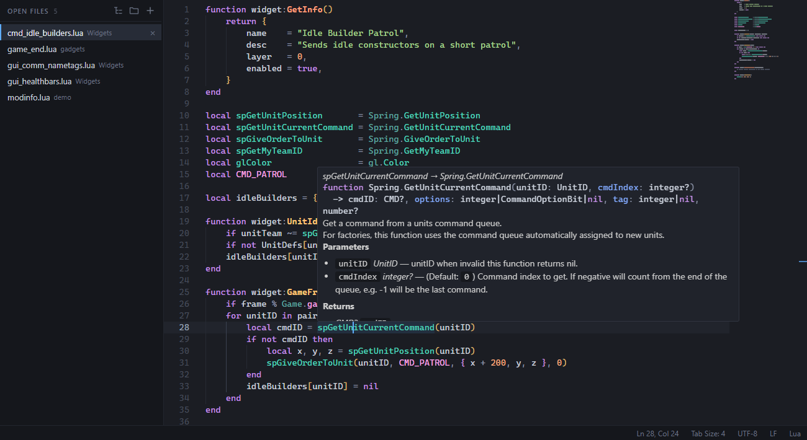
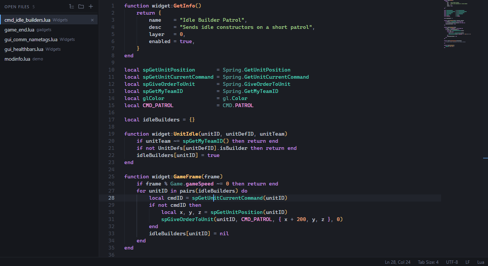

# CoilEdit

**A lightweight code editor made for Recoil engine game development**, with the Recoil Lua API built in.

If you write widgets, gadgets, unit scripts or game logic for [Beyond All Reason](https://www.beyondallreason.info/) or another game on the [Recoil engine](https://github.com/beyond-all-reason/RecoilEngine) (the successor to Spring RTS), CoilEdit knows the engine API. Hover any engine call and you see what it does without leaving the editor or digging through the wiki.

### The Recoil glossary, built in

- **Hover docs for the whole engine API.** That covers `Spring.*`, `gl.*`, `CMD.*`, `Game.*`, `VFS.*`, `Spring.MoveCtrl.*` and the rest: about 1,500 functions and 1,000 constants, with descriptions, parameters, return values and a link to the engine source.
- **It follows your aliases.** After `local spGetUnitPosition = Spring.GetUnitPosition`, hovering `spGetUnitPosition` anywhere in the file shows the real docs.
- **Callins too.** Hover `widget:UnitCreated` or `gadget:GameFrame` to see when it fires and what it receives. Typing `function widget:` lists every callin with its parameters filled in.
- **Completion and parameter hints.** Type `Spring.` for a documented list. Type `(` and the current argument is highlighted as you go.
- **Color-coded engine code:**
  - engine callouts in teal
  - engine callins in gold
  - widget/gadget-handler call-ins in coral
  - engine constants in pink

  A misspelled API name stays uncolored, so typos stand out right away.
- **Stays current.** Pull the latest API docs from GitHub with one click, or load them from your game repo's `recoil-lua-library` submodule. You can also read the handler call-ins from your own game's `luaui/` and `luarules/`.

### An editor that stays out of the way

- **No projects or workspaces.** Open files from anywhere, Notepad++ style.
- **Vertical tabs that stay sorted A–Z**, each showing its folder. Optionally group them by folder, which helps when several games or mods are open at once.
- **Picks up where you left off.** Tabs, cursor positions and unsaved edits all come back after a restart.
- **The VS Code editing engine (Monaco):** multi-cursor, find/replace, bracket matching, and highlighting for dozens of languages.
- **Small and native:** a 4 MB installer for Windows, Linux and macOS.

## Install

Download the installer for your system from the [Releases](https://github.com/ScarylePoo/coiledit/releases) page.

| System | File | Notes |
| --- | --- | --- |
| Windows | `CoilEdit_x.y.z_x64-setup.exe` (or `.msi`) | Installs for your user only, so no admin rights are needed. Adds **Edit with CoilEdit** to the right-click menu of every file (on Windows 11 it's under "Show more options") and lists CoilEdit under **Open with** for code and text types. It never makes itself the default program for anything. To use it as the default for a type, right-click a file → Open with → Choose another app → CoilEdit → Always. |
| Linux | `.AppImage`, `.deb`, or `.rpm` | The AppImage runs anywhere: `chmod +x` it and launch it. |
| macOS | `CoilEdit_x.y.z_universal.dmg` | Runs on both Apple Silicon and Intel Macs. |

The builds aren't code-signed, so the first launch shows a warning:

- **Windows:** SmartScreen may say "Windows protected your PC". Click **More info → Run anyway**.
- **macOS:** open the app once, then go to **System Settings → Privacy & Security** and click **Open Anyway**.

## Develop

CoilEdit is a [Tauri 2](https://tauri.app) app. The UI is plain HTML/JS in `src/`, with [Monaco](https://microsoft.github.io/monaco-editor/) as the editor. A small Rust backend in `src-tauri/` handles file I/O.

Prerequisites: Node.js, Rust, and the [Tauri system dependencies](https://tauri.app/start/prerequisites/) for your OS. On Windows that means the MSVC Rust toolchain plus Visual Studio C++ Build Tools.

- `npm install`, then `npm run dev` to run from source.
- `npm run build` builds the installers into `src-tauri/target/release/bundle/`.
- `npm run recoil-docs` refreshes the bundled Recoil API snapshot from GitHub.

**Releases:** push a tag like `v0.2.1` and GitHub Actions builds Windows, Linux, and macOS installers and attaches them to a **draft** release. Review it and click Publish. You can also start a build without a release from **Actions → Build → Run workflow**.

Layout:

- `src/`
  - `renderer.js` — tabs, sessions, the editor
  - `recoil.js` — hovers, completion, and coloring
  - `recoil-docs.js` — the annotation parser
  - `platform.js` — menus, dialogs, and native calls
- `src-tauri/src/main.rs` — file reading and writing with encoding detection, change polling, and config storage
- `tools/`
  - `copy-monaco.js`
  - `recoil-docs-cli.js`
  - `icon.svg` / `icon-1024.png` — the app icon source. Regenerate the platform icons with `npx tauri icon tools/icon-1024.png -o src-tauri/icons`.

## Tabs

- Tabs run down the left side and stay sorted A–Z. The dim text after each name is the file's parent folder.
- The tree button (`Ctrl+Shift+G`) groups tabs by folder. Click a folder header to collapse it, or right-click it to close that folder's tabs.
- Middle-click closes a tab. Right-click gives close others / close saved / close same folder / copy path / reveal in your file manager.
- Double-clicking empty sidebar space opens a new file. Drag the sidebar edge to resize it.

## Keys

| Key | Action |
| --- | --- |
| Ctrl+P | Jump to an open tab or recent file (MRU order, fuzzy filter) |
| Ctrl+R | Recent files |
| Ctrl+Tab / Ctrl+Shift+Tab | Next / previous tab (sidebar order) |
| Ctrl+Shift+T | Reopen closed tab |
| Ctrl+B | Toggle sidebar |
| Alt+Z | Word wrap |
| Ctrl+M | Minimap |
| Ctrl+= / Ctrl+- / Ctrl+0 | Font size |
| Ctrl+Alt+L | Language mode |
| F1 | Command palette |

Find, replace, multi-cursor, and the other Monaco/VS Code editing keys all work.

## Behaviour

- Like Notepad++, closing the window never prompts. Open tabs, cursor positions, and unsaved edits (including untitled buffers) all come back on the next launch.
- When a file changes on disk, a clean tab reloads silently. A tab with unsaved edits asks first. Deleted files show struck-through in red.
- Encoding (UTF-8, UTF-8 BOM, UTF-16 LE, Windows-1252) and line endings are detected and preserved. Click either one in the status bar to change it.
- Opening a file from your file manager while CoilEdit is running adds it to the existing window.
- On macOS, use Cmd wherever this README says Ctrl (Ctrl+Tab stays Ctrl+Tab).

## Recoil Lua API docs

Lua files get documentation for the Recoil engine API:

- **Hover** over `Spring.*`, `gl.*`, `CMD.*`, `Game.*`, `VFS.*`, and the rest to see the signature, description, parameters, returns, and a link to the engine source.
  - Local aliases are followed, so `local spGetUnitPosition = Spring.GetUnitPosition` makes `spGetUnitPosition` hoverable too.
  - Callins work as well, e.g. `function widget:UnitCreated(...)`.
  - Type names like `UnitID` show their definition.
- **Completion** after `Spring.` / `gl.` / `Spring.MoveCtrl.` / an alias. After `function widget:` it offers callins with their parameters filled in.
- **Coloring**: engine callouts are teal, engine callins are bold gold, widget/gadget-handler call-ins (`GetInfo`, `TextCommand`, `VisibleUnitAdded`, …) are bold coral, and engine constants are pink. Aliases get the same color as the name they stand for. A misspelled API name stays uncolored.
- **Parameter hints** appear when you type `(` or `,`. For functions with overloads, use the arrows to page through them.

The data comes from the [recoil-lua-library](https://github.com/beyond-all-reason/recoil-lua-library) annotations. A snapshot ships in `src/data/recoil-api.json`. To refresh it:

- **Recoil → Update API Docs from GitHub** pulls the latest.
- **Recoil → Load API Docs from Local Folder…** reads a checkout, e.g. your game repo's submodule.
- `npm run recoil-docs` regenerates the bundled snapshot.

Handler call-ins come from the game's own handler files. The default list is taken from Beyond All Reason's `luaui/barwidgets.lua` and `luarules/gadgets.lua`.

- **Recoil → Load Handler Call-ins from Game Folder…** reads another game's handlers. Pick the folder that contains `luaui/` and `luarules/`.
- **Recoil → Reset Handler Call-ins to Default (BAR)** goes back to the default list.

## License and credits

CoilEdit's own code is released into the public domain under the [Unlicense](LICENSE).

Some bundled pieces come from other projects and keep their own licenses:

- **Recoil API docs** (`src/data/recoil-api.json`) are generated from the [recoil-lua-library](https://github.com/beyond-all-reason/recoil-lua-library) annotations. Those annotations are extracted from the source of the [Recoil engine](https://github.com/beyond-all-reason/RecoilEngine), which is licensed under the GNU GPL. The descriptions belong to the Recoil engine developers and fall under its license, not the Unlicense. The same applies to API docs you download in the app with **Recoil → Update API Docs from GitHub**.
- **Handler call-in names** (`src/data/handler-callins.json`) are taken from [Beyond All Reason](https://github.com/beyond-all-reason/Beyond-All-Reason)'s `luaui/barwidgets.lua` and `luarules/gadgets.lua`.
- **[Monaco Editor](https://github.com/microsoft/monaco-editor)** is © Microsoft, MIT license.
- **[Tauri](https://tauri.app)** is MIT / Apache-2.0.

Thanks to the Recoil and Beyond All Reason developers for documenting the engine API in a machine-readable form.
